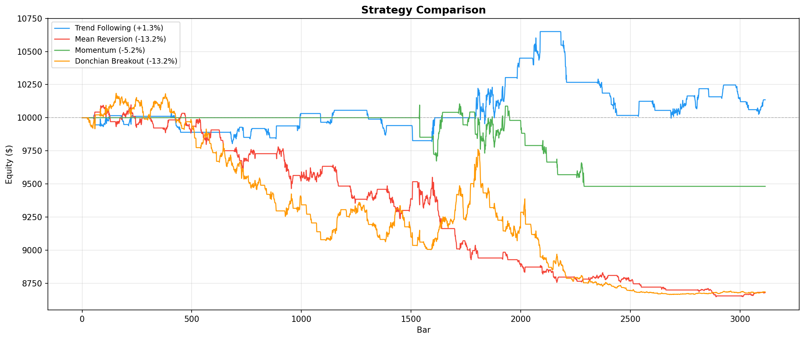

# Backtesting Engine

[](https://github.com/lucas-guerin-44/backtesting-engine/actions/workflows/test.yml)

Event-driven backtesting engine built for execution realism.  
Gap-aware stops, explicit commission/slippage, market impact, and funding accrual,
with a shared-account multi-instrument portfolio runner and a fast vectorized
screening path.

Data sourced from [lucas-guerin-44/datalake-api](https://github.com/lucas-guerin-44/datalake-api).

> The experimental tick engine, latency broker, FIFO order book, and Cython tick
> core live on the `experimental/tick-cython` branch. `main` is focused on the
> bar-level event engine, the portfolio engine, and the pure-Python vectorized
> screener/optimizer.


*Four strategies + buy & hold on XAUUSD D1 (2012-2025). 5bps commission, 0.4bps spread. Walk-forward validated — see [research process](docs/research.md).*

## Why this engine

Most backtesters optimize for speed or ease of use. This one optimizes for **not lying to you**.

- **No lookahead bias.** Signals fire on bar close, fills happen at the next bar's open. The engine never sees the future.
- **Execution realism.** Gap-aware stops fill at the open when price gaps through — not at the stop level.
- **Explicit costs.** Commission and spread/slippage are configurable. Optional market impact scales with `sigma * sqrt(Q/ADV)` when ADV and daily volatility are supplied. Funding/swap accrues over elapsed bar time.
- **Statistical honesty.** Walk-forward validation, Deflated Sharpe Ratio (corrects for multiple testing), bootstrap confidence intervals, permutation tests. The optimizer doesn't just find params — it tells you if they're real.

## Quick start

```bash
pip install -e .    # from backtesting-engine/
```

```python
from backtesting.backtest import Backtester
from backtesting.types import BacktestConfig
from strategies import MomentumStrategy

config = BacktestConfig(
    starting_cash=10_000,
    commission_bps=5.0,
    spread_bps=0.4,               # measured from MT5 M1 data
    funding_rate_annual=5.0,       # long swap rate %
    funding_rate_short=8.0,        # short swap rate %
)

bt = Backtester(df, MomentumStrategy(trend_filter_period=200), config=config, symbol="XAUUSD")
equity_curve, trades = bt.run()
```

## Multi-asset portfolio backtests

`PortfolioBacktester` runs one strategy per symbol against a shared cash, leverage, margin, and drawdown account. Symbols with different bar calendars are merged as an event stream; a symbol without a new bar is marked at its last close. Simultaneous eligible entries are scaled pro rata against shared buying power and optional portfolio risk limits. Per-symbol `max_stale_hours` can flag or reject marks from old bars (`stale_mark_policy="warn"` by default; use `"error"` to fail closed).

```python
from backtesting.portfolio_backtest import PortfolioBacktester, PortfolioRiskLimits
from backtesting.instruments import InstrumentSpec

bt = PortfolioBacktester(
    data={"ASSET_A": asset_a_df, "ASSET_B": asset_b_df},
    strategies={"ASSET_A": strategy_a, "ASSET_B": strategy_b},
    config=BacktestConfig(starting_cash=100_000, commission_bps=2.0),
    account_currency="USD",
    instrument_specs={
        "ASSET_A": InstrumentSpec(contract_multiplier=1.0),
        "ASSET_B": InstrumentSpec(contract_multiplier=10.0, max_stale_hours=36),
    },
    risk_limits=PortfolioRiskLimits(
        max_total_risk_fraction=0.06,
        max_symbol_gross_leverage=1.0,
    ),
)
equity_curve, trades = bt.run(liquidate_at_end=True)
```

An `InstrumentSpec` is required for every symbol so contract assumptions are explicit. Contract multipliers affect P&L, notional, commission, margin, impact sizing, and built-in strategy risk sizing. All instruments must be quoted in the account currency; FX conversion and portfolio optimization across symbols are not supported by this runner yet.

Benchmark the portfolio event loop with `python benchmarks/bench_portfolio.py --bars 50000 --symbols 4 --runs 3`.

## Architecture

```
strategies/              4 included (trend, reversion, momentum, donchian)
    ↓ on_bar()
backtesting/
    backtest.py          Event-driven engine (canonical, ~300k bars/sec)
    portfolio_backtest.py Shared-account multi-instrument event engine (canonical)
    vectorized.py        Pure-Python screening/optimizer fast path
    ↓
    broker.py            Gap-aware stops, slippage, commission
    portfolio.py         Equity, drawdown, margin calls, funding accrual
    statistics.py        Sharpe, bootstrap CI, Deflated Sharpe Ratio
    indicators.py        EMA/ATR/RSI kernels (optional Cython `_core` accel)

optimizer.py             Optuna TPE + walk-forward validation
```

**Bar-level flow:** stop exits → TP exits → strategy signal → entry at next bar open → portfolio update. When both stop and TP fire in the same bar, stops execute first (conservative default).

`Backtester` (single symbol) and `PortfolioBacktester` (shared-account, multi-instrument) are the **canonical** engines — they reproduce the real strategies' execution model (per-lot stops/take-profits, scaling in, margin calls, funding, market impact).

## Vectorized engine (screening/optimizer fast path)

`VectorizedBacktester` (`backtesting/vectorized.py` + `vectorized_signals.py`) is a
pure-Python NumPy engine used as a fast optimizer/screening path
(`optimize(..., engine="vectorized")`). It uses the same signal-on-close /
fill-at-next-open convention as the canonical engine, but it is **not** a
full execution model.

Supported:

- **One sequential position at a time** (no scaling in; exits before the next entry)
- Fixed stop-loss / take-profit prices supplied per signal bar
- `risk_per_trade` sizing with drawdown-scaled scale-down
- Commission + slippage (bps), optional max-drawdown halt and cooldown

**Not supported** (use the canonical engines for these): funding/swap, market
impact, contract multipliers, multi-asset/portfolio accounting, trailing stops,
and partial fills. Latency and order-book/limit-order mechanics are not part of
`main` at all — they live on the `experimental/tick-cython` branch. Trade
direction and counts broadly agree with the canonical engine, but they are not
intended to match trade-for-trade — see `tests/test_cross_engine.py`.

## Strategies

| Strategy | Description |
|---|---|
| **Trend Following** | Dual-EMA crossover with ATR trailing stops and trend re-entry |
| **Mean Reversion** | Bollinger Band + RSI at extremes, targeting the middle band |
| **Momentum** | N-bar rate-of-change breakout (Jegadeesh & Titman 1993) |
| **Donchian Breakout** | Channel breakout, Turtle Trading style (Richard Dennis) |

All share: ATR-based position sizing, drawdown-scaled sizing (linear scale-down), circuit breaker, and trade cooldown.

## Writing a strategy

```python
from backtesting.strategy import Strategy
from backtesting.types import Bar, Trade

class MyStrategy(Strategy):
    def on_bar(self, i: int, bar: Bar, equity: float):
        return Trade(entry_bar=bar, side=1, size=equity * 0.1 / bar.close,
                     entry_price=bar.close, stop_price=bar.close * 0.98,
                     take_profit=bar.close * 1.04)
```

## Optimization

```python
from optimizer import optimize, walk_forward

result = optimize(MomentumStrategy, param_space={"lookback": (5, 40)},
                  df=df, n_trials=500, objective="sharpe")

wf = walk_forward(MomentumStrategy, param_space, df, n_splits=3, n_trials=200)
print(wf.degradation)  # IS - OOS: near-zero = real edge, large = overfitting
print(wf.oos_sharpe, wf.oos_total_return_pct)  # stitched chronological OOS result
```

Pass `seed=...` to `optimize()` or `walk_forward()` for reproducible trials (`n_jobs=1`).
Annualization is estimated from observed bars per elapsed calendar year; pass `freq_per_year=...` to `Backtester`, `optimize()`, or `walk_forward()` to select a market-calendar convention, especially for short or irregular samples.
Walk-forward OOS folds warm incremental strategy state from prior training bars; built-in strategies choose a warm-up horizon, while custom strategies can override `warmup_bar()` and `warmup_bars`.

## Tests

286 tests, ~5s. Cross-engine consistency checks, walk-forward contamination regression, indicator edge cases, and multi-asset portfolio execution. (The tick/latency/order-book suite runs on the `experimental/tick-cython` branch.)

```bash
python -m pytest tests/ -x -q
```

## See also

- **[datalake-api](https://github.com/lucas-guerin-44/datalake-api)** — Data pipeline for OHLC/tick data
- **[docs/research.md](docs/research.md)** — Research process: diagnosing overfitting, fixing methodology
- **[docs/backtester_engineering.md](docs/backtester_engineering.md)** — Full engineering walkthrough
- **`experimental/tick-cython` branch** — tick engine, latency broker, FIFO order book, Cython tick core

## Known limitations

- Session filtering is at the data layer (`load_data()` in `utils.py`), not in the engine itself.
- No corporate action adjustments (splits, dividends) — use adjusted data.
- Intra-bar execution realism (tick fills, latency, order book) is not part of `main`; it lives on the `experimental/tick-cython` branch. Partial fills are likewise not modeled by the canonical bar-level engines.
- The vectorized engine is a screening fast path, not a full execution model (see above).
